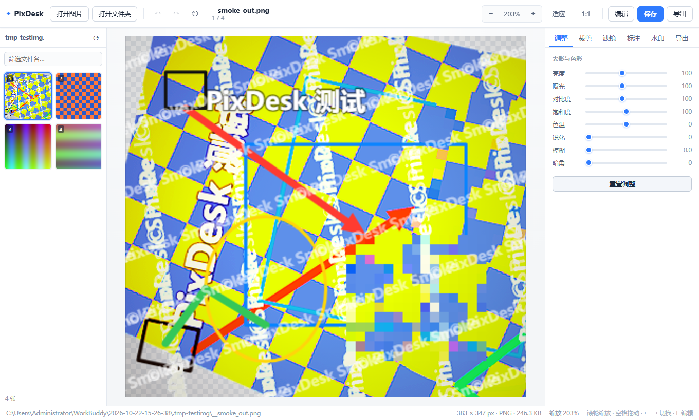
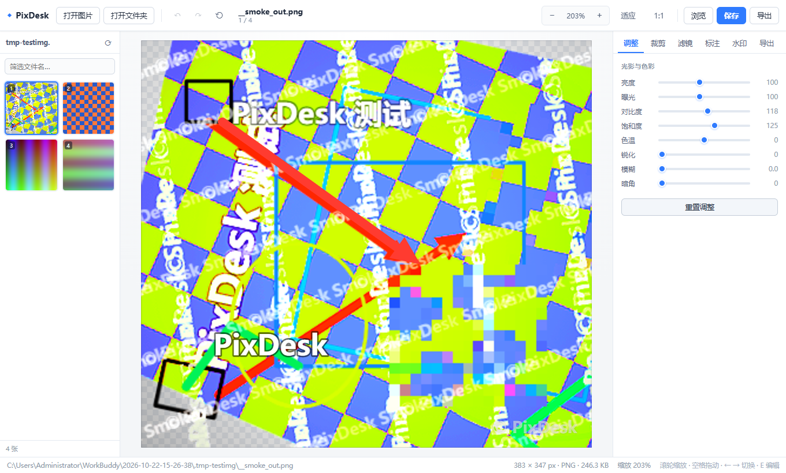

# PixDesk

轻量级桌面**看图 / 修图**工具。Electron + 原生 Canvas 2D 实现，运行时零第三方依赖，单仓库即可构建。




## 功能

**看图**
- 打开文件夹 / 多选图片 / 拖拽进窗口，缩略图栏 + 文件名筛选
- `←` `→` 切换、滚轮缩放、空格拖拽平移、适应窗口 / 1:1、幻灯片播放、全屏
- 透明区域棋盘格底，支持 JPG / PNG / WebP / GIF / BMP / AVIF / SVG / TIFF

**修图**（非破坏式，全部实时预览，随时撤销重做）
- 调整：亮度、曝光、对比度、饱和度、色温、锐化（USM 卷积）、模糊、暗角
- 滤镜：黑白 / 复古 / 冷调 / 暖阳 / 鲜艳 / 胶片 / 褪色 / 反相
- 裁剪：自由拖拽 + 8 种比例锁定，旋转 90°、水平/垂直翻转、±45° 微调
- 标注：画笔、箭头、矩形、椭圆、文字、马赛克
- 水印：文字水印，字号 / 透明度 / 颜色 / 九宫格位置 / 平铺
- 导出：PNG / JPEG / WebP，质量与尺寸可调，支持**一键批量套用到整个文件夹**
- 保存：覆盖保存前自动在原目录生成 `.bak` 备份

## 运行

```bash
npm install
npm start
```

> Windows 下若设置了 `ELECTRON_RUN_AS_NODE=1`，请先 `unset ELECTRON_RUN_AS_NODE`（或 `set ELECTRON_RUN_AS_NODE=`），否则 Electron 会以纯 Node 模式启动。

## 打包安装包

```bash
npm install -D electron-builder
npm run dist     # 生成 NSIS 安装包（win）
```

## 开发

```bash
npm run smoke    # 冒烟测试：真实主进程 + 注入脚本，验证渲染管线 / IPC / 写盘回读
npm run shot     # 截图到 .shots/（PIXDESK_MODE=edit 截编辑模式）
```

冒烟测试需要测试图片目录：

```bash
PIXDESK_DIR=/path/to/images npx electron scripts/smoke.js
```

## 技术要点

- **同源自定义协议** `pixdesk://local/...`：页面与图片同源，规避 Canvas 跨域污染，导出与像素级处理（色温 / 锐化 / 马赛克）才不会被 `getImageData` 卡住
- **预览 / 导出双分辨率**：预览按显示尺寸上限渲染（拖动滑杆时降采样到 1200px 保证流畅），导出全分辨率重算
- 标注与水印只存归一化坐标矢量数据，预览阶段不落盘，任意分辨率导出都清晰
- `contextIsolation` + `preload` 桥接，renderer 不接触 Node 能力；CSP 关闭内联脚本

## 已知限制

- 每张图的编辑参数不跨会话/跨图保存（切换图片即重置）
- GIF 动图在画布中只显示第一帧，导出为静态图
- 16 位 TIFF、EXR 等专业格式依赖 Chromium 解码能力

## License

MIT
